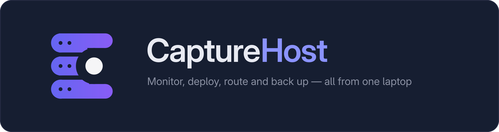

<p align="center"></p>

# CaptureHost

A self-hosted hosting dashboard for one laptop: watch the machine, control
Docker, deploy a GitHub repo behind a hostname, back it all up — from a single
private web UI, with no cloud account.

It is **inspired by Coolify and CapRover** and deliberately smaller: one machine,
one admin, no clustering. It was built as a learning project (BCA), which is why
it spends its effort on the parts those tools hide — a container policy you can
read and attack, signature-checked webhooks, blue/green swaps, Caddy routes
reconciled from SQLite, encrypted backups, and a security doctor you can run from
a shell.

Known limits, stated up front: **single machine only**; deployments need a
**Dockerfile** (no buildpack detection); `public` Caddy mode is **untested**; and
deploy **only repositories you trust** — a build runs that repo's code here.

**Status: all six phases complete** (monitoring, auth, Docker, deployments,
domains/Caddy, backups + hardening). [PROGRESS.md](./PROGRESS.md) is the
authoritative project state; [deploy/README.md](./deploy/README.md) is the
production setup and [deploy/DESIGN-NOTE.md](./deploy/DESIGN-NOTE.md) explains
why the backend runs as a systemd service rather than in a container.

Development runs with one command — `python3 capturehost.py` starts the socket
proxy, Caddy, the API and the Vite dev server in dependency order and stops them
again on Ctrl-C ([details](#run-everything-with-one-command)); production runs
under systemd.

## Stack

| Layer | Choice |
|---|---|
| Backend | Node 20+, TypeScript, Fastify 5, `@fastify/websocket`, zod |
| Data | SQLite (`better-sqlite3`, WAL) with numbered migrations |
| Frontend | React 19, Vite, TypeScript, plain CSS (dark theme) |
| Metrics | `systeminformation` + `nvidia-smi` (GPU, optional) |
| Proxy | Caddy, driven through its admin API (routes tagged `capturehost-<id>`) |
| Ops | encrypted backups, notification feed, retention jobs, security doctor |

## Requirements (Arch Linux)

```bash
sudo pacman -S --needed nodejs npm git sqlite docker
sudo systemctl enable --now docker
# optional, only if you want GPU metrics:
sudo pacman -S --needed nvidia-utils
```

Docker needs your user in the `docker` group for Phase 3:

```bash
sudo usermod -aG docker "$USER"   # log out and back in afterwards
```

## Run it (development)

Two processes: the API on `127.0.0.1:8787` and the Vite dev server on
`127.0.0.1:5173` (which proxies `/api` and `/ws` to the backend, so the browser
only ever sees one origin). The steps below are the one-time setup; after that,
`python3 capturehost.py` starts the whole stack (see the next section).

```bash
git clone <your-repo> capturehost && cd capturehost

# backend
cd backend
cp .env.example .env
openssl rand -base64 32        # paste the result into APP_ENCRYPTION_KEY
npm install
npm run setup:admin            # prompts for username + password (hidden input)
npm run dev                    # http://127.0.0.1:8787/api/health

# frontend (second terminal)
cd frontend
npm install
npm run dev                    # http://127.0.0.1:5173
```

Open <http://127.0.0.1:5173> and sign in with the account you just created.

There is no public signup and no HTTP endpoint that creates an account: the
first admin can only be created from a shell on the machine. If you lose the
password, `npm run reset:admin` (also shell-only) wipes the account so
`setup:admin` can run again.

## Run everything with one command

Once the one-time setup above is done (`.env` with a key, `npm install`, an admin
account), one script starts the four processes in dependency order — socket proxy →
Caddy → backend → frontend — each only after the previous one answers a health
probe. Python 3 standard library only; nothing to install.

```bash
python3 capturehost.py            # foreground: prefixed, colour-coded logs, Ctrl-C stops it all
python3 capturehost.py start -d   # background; returns when everything is healthy
python3 capturehost.py status     # service, state, pid, port, health
python3 capturehost.py logs backend -f
python3 capturehost.py stop       # only what this script started
```

Optional alias, so it is one word anywhere:

```bash
alias capturehost='python3 ~/capturehost/capturehost.py'
```

### Commands

| command | does |
|---|---|
| `capturehost` | start in the foreground; Ctrl-C stops everything it started (exit 130) |
| `capturehost start -d` | start detached, logs to `.run/logs/`, pids to `.run/pids.json` |
| `capturehost stop` | stop what the launcher started, in reverse order |
| `capturehost restart` | stop, then start in the foreground |
| `capturehost status` | `SERVICE / STATE / PID / PORT / HEALTH`, and `foreign` when a port is held by something it did not start |
| `capturehost logs <service>` | last 40 lines of `.run/logs/<service>.log` |
| `capturehost logs <service> -f` | follow it live; Ctrl-C stops following, not the service |
| `capturehost doctor` | runs `npm run doctor` in `backend/` (the read-only ops report) |
| `capturehost open` | opens the dashboard URL in a browser |

Flags: `--no-frontend` (proxy + Caddy + backend only) and `--prod`, which does not
start anything — production runs under systemd (`deploy/README.md`), not this script.

### Start order

| service | how | healthy when | timeout |
|---|---|---|---|
| proxy | `docker compose -f docker-compose.dev.yml up -d` | `GET /_ping` on `127.0.0.1:2375` | 45 s |
| caddy | `~/.local/bin/caddy run --config deploy/caddy/Caddyfile --adapter caddyfile` | `GET /config/` on `127.0.0.1:2019` (with the `Origin` header its API requires) | 25 s |
| backend | `npm run dev` in `backend/` | `GET /api/health` on `127.0.0.1:8787` | 90 s |
| frontend | `npm run dev` in `frontend/` | `127.0.0.1:5173` accepts a connection | 90 s |

### What it guarantees

A launcher that gets these wrong is worse than no launcher:

- **It only stops what it started.** Pids, process groups, cwds and a command-line
  marker go to `.run/pids.json` and are re-verified before any signal — a recycled
  pid fails the check and is left alone. Stop is SIGTERM to the whole process group,
  10 s, then SIGKILL, so `npm`'s `tsx` and `vite` children go with their parent.
- **Container-safe.** The proxy is stopped with `docker compose stop` for this repo's
  compose file only. Containers created by deployments, and anything else on the
  machine, are never touched.
- **Idempotent.** A second start reports `already running (pid …)` per service and
  starts nothing.
- **Loud about port conflicts.** Before each start it checks the port; if something
  else holds it, it prints the owner from `ss`, exits non-zero and rolls back what it
  had already started. It never kills a process it did not start.
- **A failed start never leaves half a stack.** Compose failure, a service that exits
  during startup, or a health timeout all run the same shutdown path.
- **No privilege, no shell.** Argument lists with explicit cwds, no `sudo`, no
  `shell=True`. Docker is checked, never started: it tells you to run
  `sudo systemctl start docker` and exits.
- **Preflight before anything starts.** `node`, `npm` and `docker` on `PATH`; the
  daemon reachable; `backend/.env` present and mode `600` (it prints the `chmod`, it
  never edits the file); `node_modules` present or installed after saying so.
- **No restart loops.** If a service dies in the foreground it names it, stops the
  rest and exits non-zero.

Logs live in `.run/logs/<service>.log`, rotated at 5 MB (`.run/` is git-ignored).
The helpers have unit tests: `python3 -m unittest discover -s tests -v` (21 tests —
port checks, health waits with timeouts, pid verification, log rotation, the state
file).

## Verify

```bash
curl -s http://127.0.0.1:8787/api/health
curl -s "http://127.0.0.1:8787/api/metrics/history?range=1h" | head -c 300

cd backend  && npx vitest run          # 77 tests
cd frontend && npm run typecheck && npm run build
```

## Build for production

```bash
cd backend  && npm run build && npm start     # dist/index.js, still 127.0.0.1
cd frontend && npm run build                  # static files in dist/
```

## Docker access (privileged, proxied)

The dashboard can start, stop, restart and remove containers — so it must not
hold the Docker socket. Only a proxy container does, mounted read-only:

```bash
docker compose -f docker-compose.dev.yml up -d     # socket proxy on 127.0.0.1:2375
```

`tecnativa/docker-socket-proxy` is pinned and exposes exactly what the UI needs
(`CONTAINERS`, `IMAGES`, `INFO`, `EVENTS`, `PING`, `POST`, `BUILD`). Everything else
— `EXEC`, `VOLUMES`, `NETWORKS`, `SECRETS`, `SYSTEM`, `SWARM`, `PLUGINS`, `SESSION`,
`GRPC` — stays at 0, so a compromise of the dashboard cannot exec into a container
or prune the host. `BUILD` is only needed for Phase 4's `POST /build`; BuildKit
(`SESSION`/`GRPC`) stays off, so the classic builder is the only path.

Because the proxy filters **URLs and methods, not request bodies**, the backend
enforces container safety itself (`backend/src/services/containerPolicy.ts`).

Three things are enforced in the backend, not just hidden in the UI:

- the proxy container (labelled `capturehost.protected=true`) and anything in
  `DOCKER_PROTECTED_CONTAINERS` cannot be stopped, restarted or removed (403,
  audited);
- a running container cannot be removed (409) — stop it first;
- `container inspect` returns environment **key names**, never values.

To verify the backend has no socket access:

```bash
PID=$(pgrep -f "index[.]ts"); ls -l /proc/$PID/fd | grep -c docker.sock   # -> 0
docker inspect capturehost-socket-proxy --format '{{range .Mounts}}{{.Source}} rw={{.RW}}{{end}}'   # -> rw=false
```

Live end-to-end check (creates and removes only its own labelled container):

```bash
DOCKER_API_PASSWORD='…' node scripts/integration-docker.mjs
```

## Deploy a site from GitHub

The step-by-step operator guide — what a repository needs, the form fields, deploy
states, hostnames, env vars, webhooks, rollback and troubleshooting — is
**[docs/ADD-YOUR-PROJECT.md](docs/ADD-YOUR-PROJECT.md)**. The rest of this section is
the short version.

A project = one repository, one branch, one Dockerfile, one container.

1. **Projects → New Project**: name, `https://github.com/owner/repo`, branch,
   Dockerfile path (`Dockerfile` by default) and the port the container listens on.
   A GitHub token is optional and only needed for private repositories — it is
   encrypted with `APP_ENCRYPTION_KEY` and never shown again.
2. Press **Deploy**. The pipeline clones (shallow, single branch), builds the
   Dockerfile, starts the container, health-checks it, and only then stops the
   previous one (blue/green).
3. Open `http://127.0.0.1:<host port>` — the port is shown on the project page.
   Every deploy takes a fresh port from `CONTAINER_PORT_RANGE_*`; Phase 5 puts
   Caddy in front so the hostname stops changing.

What the container gets, always (see `containerPolicy.ts`, tests included):

| Setting | Value |
|---|---|
| privileged / host network / host pid / host ipc | never |
| bind mounts, devices, docker socket | never |
| capabilities | `drop: ALL`, add back only `NET_BIND_SERVICE`, `CHOWN`, `SETUID`, `SETGID` |
| security options | `no-new-privileges` |
| memory / swap | project limit, hard-capped by `CONTAINER_MEMORY_MB_MAX` |
| CPU / pids | project limit, hard-capped |
| published port | `127.0.0.1` only, inside the configured range |
| restart policy | `unless-stopped` |
| labels | `capturehost.managed=true`, `capturehost.project=<id>` |

**Webhook auto-deploy.** Each project has a secret shown in *Settings → Webhook*.
GitHub signs the body with HMAC-SHA256 (`X-Hub-Signature-256`); the backend verifies
it over the raw bytes before parsing JSON, only accepts `push` to the project's
branch, and deduplicates by `X-GitHub-Delivery`. Since the backend listens on
127.0.0.1, expose **only** `/api/webhooks/github/<id>` through a tunnel before
adding the webhook in the repository settings.

```bash
# manual webhook smoke test (no tunnel needed, talks to loopback directly)
BODY='{"ref":"refs/heads/main","after":"<sha>"}'
SECRET='<from Settings → Webhook>'
SIG=$(printf '%s' "$BODY" | openssl dgst -sha256 -hmac "$SECRET" -hex | sed 's/^.*= //')
curl -i -X POST http://127.0.0.1:8787/api/webhooks/github/1 \
  -H 'content-type: application/json' -H 'x-github-event: push' \
  -H "x-github-delivery: manual-$RANDOM" -H "x-hub-signature-256: sha256=$SIG" \
  --data-raw "$BODY"

# full end-to-end check: create → deploy → redeploy → rollback → delete
cd ~/capturehost/backend && node scripts/integration-deploy.mjs
```

Rollback re-runs the previous successful image without rebuilding. Images are
tagged `capturehost/<slug>:<short-sha>` and pruned to `DEPLOY_KEEP_IMAGES` (3).

## Databases (Postgres)

Create a Postgres container from the dashboard, link it to a project, browse its
data, back it up and restore a snapshot. One container per database, data on a
**named volume only**, and nothing else on this machine changes.

### What it creates, and the one mount it may have

| Setting | Value |
|---|---|
| Image | `postgres:17-alpine` or `postgres:16-alpine` — pinned tags, no `latest` |
| Data | named volume `capturehost-db-<id>` → `/var/lib/postgresql/data` |
| Network | `capturehost-apps`, reachable by container name (`capturehost-db-<id>:5432`) |
| Published port | optional, **`127.0.0.1` only**, from `CONTAINER_PORT_RANGE_*` |
| Limits | 512 MB / 0.5 CPU by default, same clamps and ceilings as apps |
| Capabilities | `CHOWN`, `FOWNER`, `SETUID`, `SETGID` and nothing else |

The container policy refuses every mount for applications. A database gets exactly
one exception — a named volume derived from **its own id**, at the image's data
path — enforced in `services/databasePolicy.ts` and re-validated on the finished
payload. Host paths, `docker.sock`, `:ro`/`:rw` suffixes, a second mount, a
different volume, privileged mode, devices and host namespaces still throw.

The four capabilities are not optional: without them `docker-entrypoint.sh` cannot
`chown` its data directory and the container crash-loops with
`chown: /var/lib/postgresql/data/pgdata: Operation not permitted`.

### Three ways to start a database

**New database** offers:

| Mode | What happens |
|---|---|
| **Empty** | a fresh container and an empty database |
| **Clone existing** | `pg_dump` of a running CaptureHost database, replayed into a new one — the source is only read |
| **Upload a dump** | a `pg_dump` archive (`-Fc` or `-Ft`) or a plain `.sql` file, gzipped or not |

Uploads are the raw request body, streamed straight to
`data/backups/imports/` and deleted in a `finally` — the file is never buffered
in memory, so a 200 MB dump costs 200 MB of disk, not 200 MB of RSS. The floor and
ceiling:

- size cap `DATABASE_MAX_UPLOAD_BYTES` (256 MB). A gzipped file is decompressed with
  its own cap, so a zip bomb is a `413`, not a full disk;
- the format is decided by **content**, never by the file name — `PGDMP` or a tar
  header goes to `pg_restore`, printable text goes to `psql -v ON_ERROR_STOP=1 -f`,
  anything else is refused with a `400`;
- a failed import **deletes the database it just created**, so you are never left
  with an empty shell you have to clean up.

The **Import a dump** panel on an existing database is deliberately narrow: it
refuses unless that database has **no tables** and you type its name. Nothing in
this app overwrites data in place — if you want to merge, import into a new
database and link the project to it.

### Backups, and why they run in a helper container

`pg_dump -Fc` runs in a short-lived container made from the same image, on the same
network, with the archive arriving on its **stdout**. No `exec`, no `docker cp`, no
published port, no host binary (there is no `pg_dump` on this machine). The archive
is encrypted with `BACKUP_ENCRYPTION_KEY` before it touches disk, and a restore
always lands in a **new** database — `pg_restore` reads a file uploaded into a fresh
helper, never the source.

- retention: `DATABASE_BACKUP_KEEP` files per database (14), oldest pruned after
  each backup;
- schedule: `DATABASE_BACKUP_INTERVAL_MS` (6h, `0` disables), plus a manual
  **Back up now**;
- a running database with no snapshot for `DATABASE_BACKUP_MAX_AGE_HOURS` (48)
  raises a notification, and the doctor reports it.

### Linking a project

**Databases → a database → Linked projects → Link** writes `DATABASE_URL` (with the
password) into the project's encrypted env vars. A running container keeps its old
environment, so the project has to be **redeployed** — the UI says so. Unlinking
removes the env var, but only if it still holds the URL CaptureHost wrote.

### Credentials

A 32-character password is generated server-side, encrypted with
`APP_ENCRYPTION_KEY` (context `database.password`) and shown **once**, in the
response to the create call. After that the API returns the URL without the
password and the UI shows a copy-from-memory panel that disappears on dismiss.
Honest limits: `POSTGRES_PASSWORD` must be in the container's environment, so
`docker inspect` shows it to you (and root); our API, UI, logs, audit rows and
backup files never contain it, and tests scan all of them.

### The data browser and the SQL editor

The **Data** tab lists tables from `information_schema`, pages rows 200 at a time,
and runs statements you type as the database owner through the `pg` driver over the
container network. Every statement is audited (200 characters, never results), has
a `DATABASE_QUERY_TIMEOUT_MS` statement timeout, returns at most
`DATABASE_QUERY_ROW_LIMIT` rows, and is rate limited per session.

### Deleting

Delete is refused while the database is **running** or **linked**, and needs the
name typed out. The container and its row are removed; the **volume is not** — the
socket proxy runs with `VOLUMES: 0`, so this process cannot delete volumes (it also
cannot delete yours). The response names the volume and the command to remove it.

### Threat model

- **The laptop is the server, and the data lives on its disk.** Losing the laptop
  or the disk loses every database. Snapshots live under
  `data/databases/<id>/` on the same disk: **keep a copy off the machine**
  (`scp` the `.chbk` files, or restore into a database on another host).
- **There is no replication, no HA and no point-in-time recovery.** A backup is a
  snapshot from when it ran.
- **Deleting a database does not delete its data** until you remove the volume
  yourself. That is deliberate: the destructive step is yours.
- **One network.** Every app can reach every database port; the credential is the
  boundary. A compromised app gains reachability, not authentication.
- **The SQL editor is a loaded gun.** It runs as the owner of that database, by
  design, and it is session- and CSRF-protected. Nothing else in the app can run
  arbitrary SQL.

## Connect GitHub (read-only)

Without this, a project is created by pasting `https://github.com/owner/repo`.
With it, **New project → From GitHub** lists the repositories a token can see, with
private/fork/archived badges and the default branch preselected, and the same token
is used to clone private repositories (never in a URL, argument list, log or
container — see below).

### Create the token

GitHub → **Settings → Developer settings → Personal access tokens → Fine-grained
tokens → Generate new token**:

| Field | Value |
|---|---|
| Resource owner | your account |
| Repository access | *All repositories*, or *Only select repositories* |
| **Repository permissions → Contents** | **Read** — needed to list files, read the Dockerfile and clone a private repo |
| **Repository permissions → Metadata** | **Read** — mandatory once any repository permission is granted |

Nothing else. Do **not** grant `Contents: Write`, `Administration`, `Workflows`,
`Pull requests`, `Secrets` or any account permission: CaptureHost only ever issues
`GET` requests to `api.github.com`, so any write scope is dead weight on a
credential that now sits on disk.

Then **Settings → Integrations → GitHub** in CaptureHost, paste it, and optionally
record the expiry date — GitHub does not expose a token's expiry through the API, so
the date you type is the only way to get the 14-day warning (notification + doctor).

### What it stores, and what it refuses to do

- The token is encrypted with `APP_ENCRYPTION_KEY` and stored in one column. It is
  **write-only**: no API response, log line, audit row or notification ever contains
  it — there are tests that scan all four for the fixture token.
- One host, `https://api.github.com`, built from a constant; no user-supplied URL,
  `redirect: 'error'` (a 30x cannot move the request with its header), 8 s timeout.
- Read-only: only `GET /user`, `GET /user/repos`, `GET /search/repositories` and
  `GET /repos/{owner}/{repo}/contents/Dockerfile`.
- Repo lists are cached 60 s and revalidated with GitHub's ETag; a rate-limited
  answer becomes a `429` with `Retry-After` instead of a hang.
- Disconnect deletes the row and clears the cache.

Tuning, all optional: `GITHUB_API_TIMEOUT_MS` (8000), `GITHUB_CACHE_TTL_MS` (60000),
`GITHUB_REPOS_PER_PAGE` (30), `GITHUB_TOKEN_WARNING_DAYS` (14).

### Private repositories and the clone

When a project has no token of its own, the integration's token is handed to `git`
through the existing throwaway `askpass` helper (`services/git.ts`), so it never
appears in the clone URL, the argv, `ps`, the build log, a Docker build argument,
the container's environment or an image layer. A per-project token still wins if one
is set. Deploying a private repository runs **its** code on this machine — the UI
says so when you select one.

## Domains and Caddy

Deployed apps are reached through Caddy. The backend never edits
`/etc/caddy/Caddyfile`; it writes only routes tagged `capturehost-<id>` through
the admin API and re-applies them from SQLite on startup and every
`CADDY_SYNC_INTERVAL_MS` (an API-only change is lost when Caddy reloads).

```bash
# install (needs sudo) and start the base config
sudo pacman -S --needed caddy
sudo install -o root -g root -m 644 ~/capturehost/deploy/caddy/Caddyfile /etc/caddy/Caddyfile
sudo systemctl enable --now caddy

# or, for a user-local test instance with no sudo:
caddy run --config ~/capturehost/deploy/caddy/Caddyfile --adapter caddyfile
```

| Mode | What runs | Use for |
|---|---|---|
| `local` (default) | `*.localhost` on `127.0.0.1:8080`, plain HTTP | this laptop, no DNS |
| `tunnel` | same listener, Cloudflare Tunnel terminates HTTPS | sharing privately |
| `public` | direct 80/443 + automatic HTTPS (**UNTESTED**) | only with a real domain and an open inbound port |

Attach a hostname on **Domains → Add domain** (`hello.capturehost.localhost`).
`*.localhost` resolves to this machine in every browser, so no DNS setup is
needed; open `http://hello.capturehost.localhost:8080`.

Safety rules enforced in code (`services/domains.ts`), with tests:

- an upstream is only ever `127.0.0.1:<app port>` of that project's live
  container — 2375 (Docker proxy), 2019 (admin API), 8787 (backend), 8090
  (dashboard) and anything outside `CONTAINER_PORT_RANGE_*` are refused;
- hostnames must be lowercase RFC 1123 inside `ALLOWED_BASE_DOMAINS`, with no
  wildcards, IPs, underscores or trailing dot, and cannot shadow the dashboard
  or the webhook gateway;
- the dashboard lives on its own loopback listener and is never served by the
  apps listener.

On a deploy the route is moved to the new port **before** the old container is
stopped, and the hostname is probed through Caddy. If either step fails the
route is reverted and the old container keeps serving — the deployment is
marked failed.

### Public webhook gateway

`WEBHOOK_PUBLIC_HOST` turns on a gateway that lives in `deploy/caddy/Caddyfile` on
its own loopback listener (`127.0.0.1:8081`), so nothing else has to be exposed
for GitHub to reach you:

- it forwards exactly `POST /api/webhooks/github/<digits>`, body capped at **1 MB**,
  and nothing else — other methods, other paths and other hostnames on that port
  are `404`;
- the HMAC signature, delivery dedupe and per-IP rate limit are unchanged;
- the client address is taken from `CF-Connecting-IP`, and believed **only** when
  the connection comes from the local `cloudflared` (i.e. a peer in
  `TRUST_PROXY_ADDRESSES`). A header sent from anywhere else is ignored, so it
  cannot move somebody else's rate-limit bucket or lock the real admin out.

## Publish apps on your own domain

Local mode reaches apps at `http://<name>.capturehost.localhost:8080`, which only
this laptop can resolve. This section puts them on a real domain with HTTPS,
using a Cloudflare Tunnel — no port forwarding, no open inbound port, and the
dashboard stays exactly where it is: `http://capturehost.localhost:8090`.

The reference setup here is `captureordie.online`.

### 1. The values

```ini
CADDY_MODE=tunnel
ALLOWED_BASE_DOMAINS=localhost,captureordie.online
WEBHOOK_PUBLIC_HOST=hooks.captureordie.online
TRUST_PROXY=true
TRUST_PROXY_ADDRESSES=127.0.0.1,::1
SESSION_COOKIE_SECURE=false
```

Why these and not the obvious alternatives:

| Setting | Value | Reason |
|---|---|---|
| `CADDY_MODE` | `tunnel` | apps stay on the plain-HTTP loopback listener; Cloudflare terminates TLS |
| `ALLOWED_BASE_DOMAINS` | both bases | `localhost` stays in the list so `hello.capturehost.localhost` keeps working locally; real domains get their own rules |
| `TRUST_PROXY` | `true` | Caddy is in front of Fastify, so `X-Forwarded-*` may be read — but only from the addresses below |
| `TRUST_PROXY_ADDRESSES` | loopback | the same list decides when `CF-Connecting-IP` is believed. Never add a public address here |
| `SESSION_COOKIE_SECURE` | **`false`** | you log into the dashboard on `http://capturehost.localhost:8090`. A `Secure` cookie is not sent over plain HTTP, so `true` locks you out of your own dashboard. The cookie never leaves the machine, and the dashboard is not in the tunnel |

Then restart: `python3 capturehost.py restart`. Domain URLs in the dashboard switch
to `https://<name>.captureordie.online` automatically for public bases, and
localhost names keep their `:8080`.

### 2. Hostname rules

Enforced in `services/domains.ts` (with tests) and reported by the doctor:

- **exactly one label** under a real base domain: `app.captureordie.online` — never
  `a.b.captureordie.online`;
- **the apex is refused**: `captureordie.online` itself is not attachable;
- **reserved names are refused**: `www`, `hooks`, `capturehost`, `admin`,
  `dashboard`, `api` — in every base domain;
- `localhost` keeps the older dev convention (`hello.capturehost.localhost`) because
  that base is a TLD stand-in, not a domain you own.

### 3. Threat model — read this before you turn it on

1. **Every deployed app becomes reachable by the whole internet.** The container
   runs a Dockerfile from a repository you chose. Deploy only repositories you
   trust: the build executes that code on this machine, and the running app is
   exposed to anyone who finds the hostname.
2. **The laptop must stay awake and online.** It is now the server. Sleep, a
   suspended lid or a dropped connection makes every public hostname fail with a
   502 from Cloudflare. There is no fallback, no replica and no uptime guarantee.
3. **The dashboard and the API are never in the tunnel.** Ingress points at
   `127.0.0.1:8080` (apps) and `127.0.0.1:8081` (webhook gateway) only. Nothing
   points at 8090, 8787, 5173, 2019 or 2375 — the doctor warns if anything does,
   including the tunnel's own config.
4. **The tunnel is the only way in.** No port forwarding, no firewall hole, no
   public IP needed. Turning it off is one process.
5. **You are now discoverable.** Your apps are on a public domain: they can be
   scanned, fuzzed and indexed. That is acceptable if the apps are meant to be
   public, and not acceptable for a personal tool that only you should reach — for
   that, use Tailscale instead.
6. **2FA is strongly recommended, and mandatory the day the dashboard is exposed.**
   As configured, the dashboard is not in the tunnel: the internet cannot reach the
   login page at all, so a password alone is a local risk, not a public one. The
   doctor warns while a public base domain is configured and 2FA is off, because the
   failure mode is someone later adding a route to `8090` and assuming it is protected
   the way the rest of this document implies.

### 4. Cloudflare side

There are two ways to own the tunnel. **Pick one.** A second tunnel is not a backup,
it is a second thing to keep in sync, and only one of them gets the DNS record. This
install uses **A** (`/etc/cloudflared/token` exists, so it runs as a system service
and its routes live in your Cloudflare account, not in a file on disk).

#### A. Tunnel created in the Cloudflare dashboard

1. Confirm the zone is **Active** on Cloudflare's Domains page — the registrar's
   nameservers have to point at Cloudflare. If it is not Active yet, everything
   below will appear to do nothing.
2. **Networks → Tunnels → `capturehost` → Routes → Add route** (published
   application), in this order:

   | # | Subdomain | Domain | Service type | URL | Serves |
   |---|---|---|---|---|---|
   | 1 | `hooks` | captureordie.online | HTTP | `127.0.0.1:8081` | the webhook gateway, one path only |
   | 2 | `*` | captureordie.online | HTTP | `127.0.0.1:8080` | deployed apps, one label each |

   `hooks` must sit **above** the wildcard: the first matching route wins. Reorder
   them if the page lets you.
3. **DNS → Records.** The wildcard is often not created for you. If a `*` record is
   missing, add it: type `CNAME`, name `*`, target
   `<tunnel-id>.cfargotunnel.com`, **Proxy status: Proxied** (orange cloud).
4. Off switch: `sudo systemctl stop cloudflared`.

**The doctor cannot see these routes.** `tunnel-targets` reads
`/etc/cloudflared/config.yml` and `~/.cloudflared/config.yml`; a
dashboard-managed tunnel has neither, so the check skips and says so. The Routes
tab is the authoritative list — review it when you change anything.

#### B. Tunnel created from the CLI

Only if no tunnel exists yet. Running this alongside an existing one creates a
second, unused tunnel.

```bash
# 1. install (sudo)
sudo pacman -S --needed cloudflared

# 2. authorise this machine and create the tunnel (opens a browser)
cloudflared tunnel login
cloudflared tunnel create capturehost           # note the tunnel UUID it prints

# 3. one DNS record: a proxied wildcard CNAME for every app hostname
cloudflared tunnel route dns capturehost '*.captureordie.online'
```

`~/.cloudflared/config.yml`:

```yaml
tunnel: capturehost
credentials-file: /home/capture/.cloudflared/<tunnel-uuid>.json

ingress:
  # first match wins — keep these two, in this order
  - hostname: hooks.captureordie.online
    service: http://127.0.0.1:8081     # webhook gateway, one path only
  - hostname: "*.captureordie.online"
    service: http://127.0.0.1:8080     # deployed apps
  - service: http_status:404           # everything else, including the apex
```

```bash
cloudflared tunnel run capturehost            # foreground, Ctrl-C stops public access

# or as a user service (no sudo, survives logout with `loginctl enable-linger capture`)
mkdir -p ~/.config/systemd/user
cat > ~/.config/systemd/user/cloudflared.service <<'EOF'
[Unit]
Description=CaptureHost Cloudflare Tunnel
After=network-online.target
[Service]
ExecStart=/usr/bin/cloudflared --config /home/capture/.cloudflared/config.yml tunnel run
Restart=on-failure
[Install]
WantedBy=default.target
EOF
systemctl --user daemon-reload
systemctl --user enable --now cloudflared
```

With this variant the doctor's `tunnel-targets` check **does** verify the ingress
file, because there is one.

**DNS:** one record, `*.captureordie.online` → `CNAME <tunnel-id>.cfargotunnel.com`,
**proxied** (orange cloud). `cloudflared tunnel route dns` creates it for you;
in the dashboard you add it by hand.

**Must not be created**, in the dashboard routes, in DNS, or in `config.yml`:

- a route pointing at `8090`, `8787`, `5173`, `2019` or `2375`;
- any public hostname for the dashboard (it is loopback-only by design);
- an `A`/`AAAA` record for the laptop's IP, or a DNS-only (grey cloud) wildcard —
  the tunnel does not work unproxied;
- a route for the bare apex, or a second-level wildcard
  (`*.*.captureordie.online`) — the hostname policy refuses those anyway;
- a second tunnel, or a second path to `8787`.

### 5. What listens where

Every listener on this machine, and the only thing that should ever be pointed at
it. Anything a tunnel points at must be one of the first two rows.

| Listener | Serves | In the tunnel? |
|---|---|---|
| `127.0.0.1:8080` | deployed apps, by `Host`, with a 404 catch-all for everything else | **yes** — the wildcard ingress target |
| `127.0.0.1:8081` | the webhook gateway: `POST /api/webhooks/github/<digits>` only, 1 MB, 404 otherwise | **yes** — the `hooks.` ingress target |
| `127.0.0.1:8090` | the dashboard (built frontend + `/api` + `/ws` for `capturehost.localhost` only) | never |
| `127.0.0.1:8787` | Fastify: the API and the WebSocket hub | never |
| `127.0.0.1:5173` | Vite dev server (development only) | never |
| `127.0.0.1:2019` | Caddy's admin API, unauthenticated by design | never |
| `127.0.0.1:2375` | Docker socket proxy, limited flags | never |

### 5. Verify it

```bash
# from this machine: the private parts are still private
curl -s -o /dev/null -w '%{http_code}
' -H 'Host: capturehost.localhost' http://127.0.0.1:8080/api/health   # 404
curl -s -o /dev/null -w '%{http_code}
' -X POST -H 'Host: hooks.captureordie.online'      http://127.0.0.1:8080/api/webhooks/github/1                                                          # 404
curl -s -o /dev/null -w '%{http_code}
' -X POST -H 'Host: hooks.captureordie.online'      http://127.0.0.1:8081/api/webhooks/github/1                                                          # 401/2xx — reached the backend

# once the tunnel is up: from your phone, off the laptop's network
#   https://<name>.captureordie.online  -> the app
#   https://hooks.captureordie.online/api/health -> 404
```

The doctor carries three checks for this: `public-private-upstreams` (no exposed
listener dials a private port), `tunnel-targets` (the tunnel's ingress file, when
one exists — it skips for a dashboard-managed tunnel), and `public-domain-2fa`.

### 6. Turning public access off

```bash
systemctl --user stop cloudflared     # or Ctrl-C in the foreground
```

That is the whole switch: DNS keeps pointing at Cloudflare, Cloudflare answers 502
for the tunnel, nothing reaches this machine, and the dashboard keeps working on
`http://capturehost.localhost:8090`. Deployed containers keep running; their
hostnames revert to `http://<name>.capturehost.localhost:8080` for you and stop
working for everyone else. To remove the exposure permanently, delete the wildcard
DNS record and the tunnel in the Cloudflare dashboard (or `cloudflared tunnel
delete capturehost`), and set `CADDY_MODE=local` again.

## Security model (short version)

- The backend binds **127.0.0.1 only**. Expose it with Tailscale or a
  Cloudflare Tunnel — never open a public port.
- **Everything under `/api` requires a session** except `GET /api/health`, the
  login endpoints and `setup-status`. New routes are protected by default.
- Passwords are argon2id (64 MB, t=3). Unknown usernames still run a dummy
  verify, so response timing does not reveal whether an account exists.
- Sessions are a 256-bit token in an httpOnly, SameSite=Strict cookie; only its
  SHA-256 is stored. Idle 30 min, absolute 12 h, rotated on every login and
  again after 2FA. Logging out (or revoking a session) closes its WebSockets.
- Writes need a session-bound CSRF token in `x-csrf-token`; the `Origin` header
  is checked against `ALLOWED_ORIGINS` on every unsafe method.
- Login throttling is per IP **and** per username, stored in SQLite so a restart
  cannot clear a lockout. Lockouts answer 429 + `Retry-After` and never say
  which limit was hit.
- Optional TOTP 2FA: secrets encrypted at rest with AES-256-GCM
  (`APP_ENCRYPTION_KEY`), codes accepted once per 30 s window, plus 8 one-time
  recovery codes stored as hashes.
- `/ws/metrics` checks the `Origin` header **and** the session cookie, because
  browsers do not apply the same-origin policy to WebSockets.
- Every query parameter is validated with zod; history has a fixed bucket
  allowlist and a hard 720-row cap.
- No shell string building anywhere: external binaries are called with
  `execFile` and argument arrays.
- Secrets live in `.env` (gitignored); `.env.example` documents every key.
- Errors are generic to the client, detailed to the server log.
- Every login, failure, lockout, logout, 2FA change, password change and session
  revocation is written to `audit_log` (never with secrets in `detail`).
- **Deployed containers are built from a fixed whitelist** (`containerPolicy.ts`):
  no privileged mode, no host namespaces, no bind mounts or docker socket, no
  devices, `drop: ALL` plus four allowlisted capabilities, `no-new-privileges`,
  memory/CPU/pids limits, loopback-only publishing. The finished payload is
  re-validated before it is sent, so a future caller cannot bypass the policy.
- **Git is never a shell string**: `execFile` with an argv array, `--` before the
  URL, `GIT_TERMINAL_PROMPT=0`, `credential.helper=` cleared, shallow clone, size
  and time limits, symlinks that escape the build context rejected.
- **GitHub tokens** travel through a one-time 0700 askpass script, never in the URL,
  argv or logs; they are stored encrypted with the same key as TOTP.
- **The webhook is the only public POST**: HMAC-SHA256 over the raw body with
  `timingSafeEqual`, verified before JSON parsing, branch-filtered, replay-safe.

## Layout

```
capturehost/
  capturehost.py     dev launcher: start/stop/status/logs for proxy + Caddy + both servers
  tests/             launcher unit tests (unittest, no dependencies)
  backend/           Fastify API, SQLite, metrics sampler, deploy pipeline
    src/db/migrations/   numbered SQL, applied once
    src/services/        metrics, docker, containerPolicy, git, deployments
    tests/               vitest: migrations, metrics, api, auth, docker, policy, git, webhook, pipeline
    scripts/             setup/reset admin, integration checks
  frontend/          React dashboard
    src/components/      one CSS file per component
    src/pages/           Dashboard, Containers, Projects + ProjectDetail, Settings, Logs
  deploy/            Caddyfile(s), systemd unit, production install guide
  docker-compose.dev.yml   socket proxy + capturehost-apps network
  PROGRESS.md        phase state, decisions, how to resume
```

## Backups and restore

```bash
cd ~/capturehost/backend
npm run backup:create              # SQLite online snapshot → gzip → AES-256-GCM
npm run backup:list                # what exists, newest first
npm run backup:verify <file>       # decrypts and runs PRAGMA integrity_check
npm run backup:restore <file>      # refuses while the backend is listening
```

Backups use `BACKUP_ENCRYPTION_KEY`, which is **deliberately a different key**
from `APP_ENCRYPTION_KEY`, so leaking one does not open the other. They never
contain `.env`: store the key somewhere off this machine or the backup cannot be
restored. Restore keeps `capturehost.db.before-restore-<ts>` beside the database
and re-runs migrations. Retention keeps `BACKUP_KEEP_DAILY` daily and
`BACKUP_KEEP_WEEKLY` weekly files, deleting only `capturehost-*.db.chbk`.

The UI does the same from **Backups**: create, list, remove, and download (which
asks for the password again, is rate limited to 3/min and is audited).

## Notifications, retention and the doctor

- **Notifications** (bell page): deploy failed, scheduled backup failed, disk
  above `NOTIFY_DISK_THRESHOLD_PCT`, Caddy unreachable or drifted, a managed
  container in a restart loop or exiting unexpectedly, a domain failing three
  checks in a row (and its recovery), a login lockout per IP, and five rejected
  webhooks for one project inside ten minutes. Events dedupe by key with a
  `NOTIFY_COOLDOWN_MINUTES` window, so a restart loop pages once.
- **Outbound channel**: one `NOTIFY_WEBHOOK_URL` (ntfy, Discord, Telegram-style).
  https only, hostname resolved and private/loopback/link-local answers refused,
  redirects not followed, short timeout, URL path (the usual secret) never shown.
- **Retention** runs hourly: audit log, build logs, webhook delivery ids, login
  attempts, read notifications, expired sessions. There is no global
  `docker prune` anywhere — images are pruned per project (keep N) and on delete.
- **`npm run doctor`** (or **Security check**): admin, 2FA, cookie flags, proxy
  trust, listeners, `docker.sock` access, proxy flags, Caddy drift, keys, backup
  age, disk, `.env` mode, git tracking. Read-only, and it never prints a secret.

## Production (option A)

The backend runs as a dedicated `capturehost` system user that is **not** in the
`docker` group, with `NoNewPrivileges`, `ProtectSystem=strict`, `PrivateTmp`,
`IPAddressAllow=localhost` and a single writable path. The proxy alone keeps a
read-only socket mount. Full sudo steps: [deploy/README.md](./deploy/README.md).

```bash
sudo install -m 644 ~/capturehost/deploy/systemd/capturehost.service /etc/systemd/system/
sudo systemctl daemon-reload && sudo systemctl enable --now capturehost
```

## Threat model — what this does NOT protect against

- **Code you deploy.** A Dockerfile is arbitrary code run on this machine at
  build time; the container policy limits what it reaches, not what it does.
- **Docker itself.** Anyone in the `docker` group is root-equivalent. The backend
  avoids the socket, but the proxy still allows create/start/remove, so a
  compromised backend controls containers.
- **A compromised host user.** Secrets are in `.env` (mode 600, checked by the
  doctor). Read access to it is equivalent to the app's keys.
- **Network attackers** are outside the model only because every listener is on
  loopback. Bind anything to `0.0.0.0` and that assumption disappears.
- **Not multi-tenant**: one admin, one machine, no per-user isolation.
- Backups survive a corrupt database, not a host compromised while the backup key
  sits on it.

## Forgot the password?

Passwords are stored as one-way argon2id hashes, so there is nothing to read
back — only to check. Prefer the offline check over guessing at the login form:
five wrong attempts lock the IP out for 15 minutes and raise an alert.

```bash
cd backend
npm run check:password                                  # dev database
npm run check:password -- --db /var/lib/capturehost/capturehost.db   # production
printf 'candidate\n' | npm run check:password           # non-interactive
```

Exit code 0 means it matches, 1 means it does not, 2 means no database or no
admin. The password is not echoed and never leaves the machine.

To rotate it, use **Settings → Security → Change password** in the dashboard, or
from a shell when the dashboard is unreachable:

```bash
cd backend
npm run change:password                                  # asks for current, then new (both hidden)
npm run change:password -- --db /var/lib/capturehost/capturehost.db
```

It verifies the current password, applies the same strength rules as the web form,
rewrites only the hash, revokes every session (you sign in again) and writes an
audit row. **2FA and the recovery codes are untouched** — unlike `reset:admin`,
which deletes the account, its sessions and its TOTP secret, and then needs
`setup:admin` to start over.

## Troubleshooting

| Symptom | Cause / fix |
|---|---|
| `Caddy is not reachable` | `systemctl status caddy`; admin API must be on `127.0.0.1:2019` |
| Deploy: `network … not found` | `docker compose up -d` (creates `capturehost-apps`) |
| Deploy: `Dockerfile missing` | path is relative to the repo root and must exist on that branch |
| Domain 404 | project has no live container, or the domain is disabled |
| Domain 502 | the container died after the swap — check Containers → logs |
| `Too many attempts` on login | lockout is per IP **and** per username |
| Everything looks like 127.0.0.1 | behind Caddy: `TRUST_PROXY=true`, keep `TRUST_PROXY_ADDRESSES` loopback |
| Doctor: `.env` mode 644 | `chmod 600 backend/.env` |
| Doctor: 2FA off | Settings → Security → Enable 2FA |
